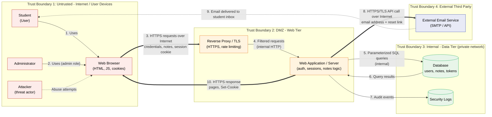
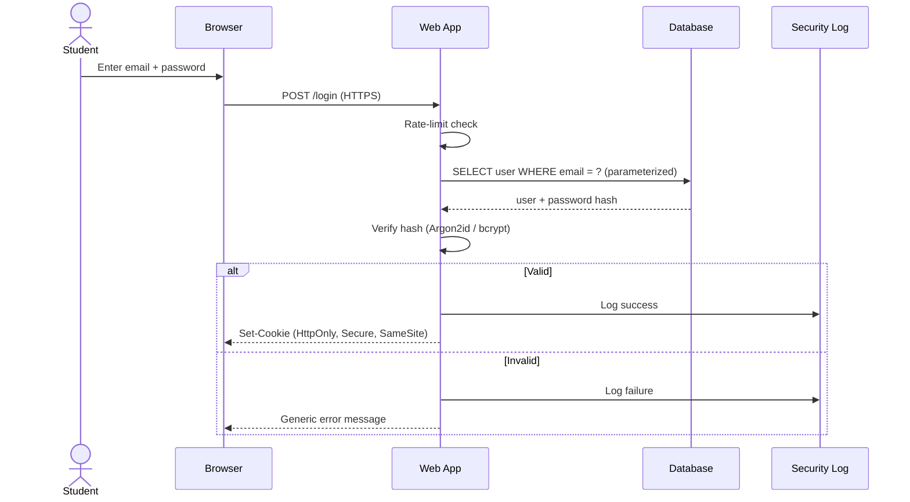
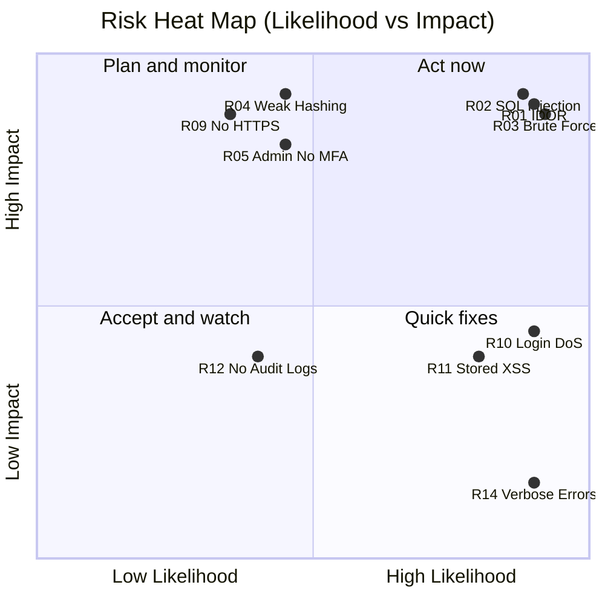

# Threat Model and Secure Configuration
### Student Login and Notes Web Application

**Track:** Cyber Security | **Level:** Beginner | **Method:** STRIDE + Likelihood x Impact risk scoring

> **Short explanation (for reviewers):** This project threat-models a small web app where students log in and keep private notes. I diagram users, data, trust boundaries and dependencies, identify threats with STRIDE, score 17 risks by likelihood x impact, and turn the highest risks into a prioritized hardening plan with verification steps.

## Contents
1. [Application Overview](#1-application-overview)
2. [Threat Model Diagram](#2-threat-model-diagram)
3. [STRIDE Threat Analysis](#3-stride-threat-analysis)
4. [Risk Assessment and Risk Register](#4-risk-assessment-and-risk-register)
5. [Security Hardening Plan](#5-security-hardening-plan)
6. [Hardening Checklist with Verification Steps](#6-hardening-checklist-with-verification-steps-portfolio-upgrade)
7. [Assignment Checklist and Conclusion](#7-assignment-checklist-and-conclusion)

---

## 1. Application Overview

### 1.1 What the application is
**StudentNotes** is a small web application where students register, log in and create private study notes. An administrator manages accounts and can disable abusive users. The app sends emails (verification, password reset) through a third-party email service.

### 1.2 Users

| User | Description | Privileges |
|---|---|---|
| Student | Registered user | Create, read, edit and delete **own** notes; change own password |
| Administrator | Staff member | Manage users (disable, reset), view audit logs; **no** access to note content by default |
| Anonymous visitor | Not logged in | Register, log in, request password reset |
| Attacker (threat actor) | External or malicious insider | Tries to abuse any of the above |

### 1.3 Assets and sensitive data

| Asset | Examples | Why it matters | Sensitivity |
|---|---|---|---|
| User credentials | Email, password hash | Account takeover | **High** |
| Session tokens | Session cookie | Equivalent to a login | **High** |
| Student notes | Study notes, personal text | Privacy; students may store personal info | **High** |
| Password reset tokens | Emailed links | Can reset any account | **High** |
| Admin accounts | Admin credentials/role | Full control of users | **Critical** |
| Personal data | Name, email address | Privacy and legal exposure | Medium |
| Audit/security logs | Login attempts, admin actions | Detection and accountability | Medium |
| Application availability | Login and notes service | Students need access during exams | Medium |
| Source code and secrets | DB password, email API key | Compromise of whole system | **High** |

### 1.4 External dependencies

| Dependency | Purpose | Risk if compromised or unavailable |
|---|---|---|
| Email service (e.g. SMTP / email API) | Verification and reset emails | Reset links intercepted; users locked out |
| Third-party libraries (npm/pip packages) | Framework, hashing, validation | Known vulnerabilities, supply-chain attacks |
| Hosting / TLS certificate authority | Server hosting, HTTPS | Downtime, certificate expiry |
| DNS | Name resolution | Redirection to fake site |

### 1.5 How the application works
1. A visitor registers with email and password. The server hashes the password and stores it in the database. A verification email is sent via the email service.
2. The student logs in. The server checks the credentials and issues a session cookie.
3. With a valid session, the student creates, reads, updates and deletes notes. Every request goes browser -> web server -> database.
4. If the password is forgotten, the server creates a one-time reset token, stores its hash, and emails a link.
5. The administrator logs in (with a separate role) to manage users and review logs.

### 1.6 Security requirements

| ID | Requirement | CIA goal |
|---|---|---|
| SR1 | Only authenticated users can access notes | Confidentiality |
| SR2 | Students can access **only their own** notes | Confidentiality |
| SR3 | Passwords are never stored in plain text | Confidentiality |
| SR4 | All traffic is encrypted (HTTPS) | Confidentiality, Integrity |
| SR5 | Admin functions require stronger authentication (MFA) | Integrity |
| SR6 | Inputs are validated; database queries cannot be manipulated | Integrity |
| SR7 | Security-relevant actions are logged | Accountability |
| SR8 | Login and public endpoints resist abuse and overload | Availability |
| SR9 | Dependencies and server software are kept up to date | All |

---

## 2. Threat Model Diagram

### 2.1 Architecture and data-flow diagram with trust boundaries



**Legend:** thick arrows `==>` = Internet communication; thin arrows `-->` = internal application communication; dotted arrows = abuse or out-of-band flows.

### 2.2 Data flow table

| # | From -> To | Data | Channel | Trust boundary crossed |
|---|---|---|---|---|
| 1-2 | User/Admin -> Browser | Credentials, note text | Local device | None |
| 3 | Browser -> Proxy | Credentials, notes, cookies | Internet (HTTPS) | TB1 -> TB2 |
| 4 | Proxy -> App | Filtered requests | Internal | Within web tier |
| 5-6 | App <-> Database | SQL queries and results | Internal (TLS recommended) | TB2 -> TB3 |
| 7 | App -> Logs | Audit events | Internal | TB2 -> TB3 |
| 8 | App -> Email service | Email, reset link | Internet (HTTPS API) | TB2 -> TB4 |
| 9 | Email service -> Student | Verification / reset email | Email network | TB4 -> TB1 |
| 10 | App -> Browser | Pages, Set-Cookie | Internet (HTTPS) | TB2 -> TB1 |

### 2.3 Trust boundary summary

| Boundary | Trust level | Rule |
|---|---|---|
| TB1 Internet / user devices | **Untrusted** | Treat every input as hostile |
| TB2 Web tier | Partially trusted | Enforce authentication, validation, rate limiting |
| TB3 Data tier | Trusted, restricted | Only the app server may connect; no public access |
| TB4 Email service | Third party | Send minimum data; protect the API key |

### 2.4 Login sequence (where spoofing and brute force occur)



---

## 3. STRIDE Threat Analysis

STRIDE is a method that checks a system against six threat types. Each threat below includes the required five details.

### 3.1 S - Spoofing (pretending to be someone else)

| Item | Detail |
|---|---|
| **Threat description** | An attacker logs in as a student or admin by guessing or reusing stolen credentials, or by stealing a session. |
| **Realistic abuse case** | An attacker takes email/password lists leaked from other websites and tries them on the login page (credential stuffing). Many students reuse passwords. |
| **Affected asset** | User credentials, session tokens, admin accounts |
| **Possible impact** | Account takeover, reading or deleting a student's notes, admin takeover |
| **Recommended control** | Strong password policy, Argon2id/bcrypt hashing, rate limiting + lockout, MFA (mandatory for admins), secure cookies, generic login errors |

### 3.2 T - Tampering (changing data without permission)

| Item | Detail |
|---|---|
| **Threat description** | An attacker modifies data or queries by injecting malicious input, or alters requests (e.g. a role field). |
| **Realistic abuse case** | The attacker enters `' OR '1'='1` in the login form to bypass authentication, or changes `role=student` to `role=admin` in a request. |
| **Affected asset** | Database, notes, user roles |
| **Possible impact** | Authentication bypass, data deletion or modification, privilege gain |
| **Recommended control** | Parameterized queries / ORM, server-side input validation, output encoding, ignore client-supplied roles, CSRF tokens |

### 3.3 R - Repudiation (denying having done something)

| Item | Detail |
|---|---|
| **Threat description** | A user or admin performs an action and no reliable record exists to prove it. |
| **Realistic abuse case** | An admin disables a student's account or resets a password, then denies it. Without logs, there is no evidence. |
| **Affected asset** | Audit logs, admin actions |
| **Possible impact** | Unaccountable actions, failed investigations, unnoticed attacks |
| **Recommended control** | Log logins, failures, resets, role changes and admin actions with timestamp, user ID and IP; store logs centrally with restricted write access; never log passwords or tokens |

### 3.4 I - Information Disclosure (exposing data to the wrong people)

| Item | Detail |
|---|---|
| **Threat description** | Sensitive data is exposed through broken access control, weak storage, unencrypted traffic or verbose errors. |
| **Realistic abuse case** | A student changes the URL `/notes/105` to `/notes/106` and reads another student's note (IDOR). On public Wi-Fi, a user on plain HTTP has the session cookie sniffed. |
| **Affected asset** | Student notes, password hashes, session cookies |
| **Possible impact** | Privacy breach, loss of trust, possible legal issues |
| **Recommended control** | Ownership check on every note request, HTTPS + HSTS, strong hashing with salt, generic error pages, encrypted database connections and backups |

### 3.5 D - Denial of Service (making the service unavailable)

| Item | Detail |
|---|---|
| **Threat description** | An attacker overloads the app so legitimate students cannot use it. |
| **Realistic abuse case** | A script sends thousands of login or registration requests per minute during exam week, or submits extremely large notes to exhaust memory and storage. |
| **Affected asset** | Web application, database, email service quota |
| **Possible impact** | Students locked out, server crash, email quota exhausted |
| **Recommended control** | Rate limiting per IP and per account, request size limits, CAPTCHA after repeated failures, timeouts, monitoring and alerts, CDN/proxy protection |

### 3.6 E - Elevation of Privilege (gaining higher access)

| Item | Detail |
|---|---|
| **Threat description** | A normal user gains admin capabilities, or an admin function is reachable without proper checks. |
| **Realistic abuse case** | A student visits `/admin/users` directly; the page hides the menu link but the server never checks the role, so it loads. |
| **Affected asset** | Admin functions, all user accounts |
| **Possible impact** | Full control of users, disabling accounts, data exposure |
| **Recommended control** | Server-side role-based access control on every admin route, deny by default, least privilege, separate admin accounts with MFA |

---

## 4. Risk Assessment and Risk Register

### 4.1 Method
- **Scale:** 1 = Low, 2 = Medium, 3 = High (for both Likelihood and Impact)
- **Risk score = Likelihood x Impact**
- **Priority:** 7-9 = **High**, 3-6 = **Medium**, 1-2 = **Low**

Possible scores are 1, 2, 3, 4, 6 and 9, so only Likelihood 3 x Impact 3 reaches **High**.



*The heat map plots a representative selection of 10 risks (the three High risks plus the most important Medium ones); all 17 are scored in the register below. Positions are qualitative.*

### 4.2 Risk register (ranked highest to lowest)

| Risk ID | Threat category | Asset | Threat description | L | I | Score | Priority | Recommended mitigation |
|---|---|---|---|---|---|---|---|---|
| R01 | Information Disclosure | Student notes | **IDOR / broken access control:** a student changes the note ID in the URL and reads or edits another student's notes | 3 | 3 | **9** | **High** | Check note ownership server-side on every request; use unpredictable IDs (UUID); automated access-control tests |
| R02 | Tampering | Database | **SQL injection** in login, search or note forms exposes or alters all data | 3 | 3 | **9** | **High** | Parameterized queries/ORM; input validation; least-privilege DB account; error suppression |
| R03 | Spoofing | User credentials | **Brute force / credential stuffing** against the login page using leaked password lists | 3 | 3 | **9** | **High** | Rate limiting, account lockout/backoff, MFA, breached-password check, generic errors |
| R04 | Information Disclosure | Password hashes | **Weak or missing password hashing** (e.g. plain text, MD5); a database leak exposes passwords | 2 | 3 | 6 | Medium | Argon2id or bcrypt with unique salts; encrypt DB and backups; restrict DB access |
| R05 | Spoofing | Admin accounts | **Admin account takeover** because admins use password-only login | 2 | 3 | 6 | Medium | Mandatory MFA for admins; IP allow-list for admin panel; separate admin accounts |
| R06 | Elevation of Privilege | Admin functions | **Role tampering or missing admin checks**: direct access to `/admin` or editing the `role` field | 2 | 3 | 6 | Medium | Server-side RBAC, deny by default, ignore client-supplied role |
| R07 | Spoofing | Session tokens | **Session hijacking/fixation** via stolen or predictable cookies | 2 | 3 | 6 | Medium | HttpOnly, Secure, SameSite cookies; regenerate session on login; short expiry; logout invalidation |
| R08 | Spoofing | Reset tokens | **Password reset abuse**: guessable, reusable or non-expiring reset tokens | 2 | 3 | 6 | Medium | Random 128-bit+ tokens, store hashed, 15-minute expiry, single use, notify user |
| R09 | Information Disclosure | Credentials, cookies in transit | **Unencrypted HTTP traffic** sniffed on public Wi-Fi | 2 | 3 | 6 | Medium | HTTPS everywhere, HTTP->HTTPS redirect, HSTS, TLS 1.2+ |
| R10 | Denial of Service | Web app | **Request flooding** of login/registration endpoints during busy periods | 3 | 2 | 6 | Medium | Rate limiting, request size limits, CAPTCHA, proxy/CDN, alerts |
| R11 | Tampering | Notes, user sessions | **Stored XSS**: malicious script saved in a note runs in a viewer's browser | 3 | 2 | 6 | Medium | Output encoding, input sanitization, Content-Security-Policy, HttpOnly cookies |
| R12 | Repudiation | Audit logs | **No audit logging**: admin or user actions cannot be proven or investigated | 2 | 2 | 4 | Medium | Structured logs for auth and admin events; centralize; alert on anomalies |
| R13 | Tampering | Application / dependencies | **Vulnerable or outdated libraries** or compromised packages | 2 | 2 | 4 | Medium | Dependency scanning, lock files, regular patching |
| R14 | Information Disclosure | Application internals | **Verbose error messages** reveal stack traces, table names or paths | 3 | 1 | 3 | Medium | Generic error pages, debug mode off in production, server-side logging only |
| R15 | Information Disclosure | User accounts | **Account enumeration** via different messages for "unknown email" vs "wrong password" | 3 | 1 | 3 | Medium | Identical responses and timing; generic reset message |
| R16 | Repudiation | Audit logs | **Log tampering** by an attacker covering tracks | 1 | 2 | 2 | Low | Append-only/remote log storage, restricted permissions |
| R17 | Tampering | User interface | **Clickjacking**: app framed inside a malicious site | 2 | 1 | 2 | Low | `X-Frame-Options: DENY` / CSP `frame-ancestors 'none'` |

### 4.3 Summary

| Priority | Count | Risks |
|---|---|---|
| High (7-9) | 3 | R01, R02, R03 |
| Medium (3-6) | 12 | R04-R15 |
| Low (1-2) | 2 | R16, R17 |

### 4.4 Why each High-priority risk needs immediate attention

**R01 - IDOR / broken access control (score 9).** This is the easiest attack on the list: it needs only a browser and a changed number in a URL, no hacking tools. It directly breaks the app's core promise (SR2: students see only their own notes) and can expose every student's private data. Access control flaws are consistently among the most common web vulnerabilities, so likelihood is high. One missing check can lead to a mass privacy breach.

**R02 - SQL injection (score 9).** A single vulnerable input can let an attacker bypass login, dump the whole database (emails, hashes, notes) or delete it. Automated tools find and exploit it in minutes, so the likelihood is high where input is concatenated into queries. Impact covers confidentiality, integrity and availability at once, and the fix (parameterized queries) is cheap before launch but very costly after a breach.

**R03 - Brute force / credential stuffing (score 9).** Billions of leaked credentials are available, students commonly reuse passwords, and attacks are automated, so likelihood is high. A success gives full access to one student's notes and, if it hits an admin, to the whole system. Rate limiting and MFA are fast to implement and stop the majority of such attacks.

**Medium risks that should follow immediately after:** R04, R05, R09 (and R06-R08) have high impact; if the likelihood rises (for example the database is exposed or the app goes public), they become High, so they are scheduled in Phase 2 of the plan.

---

## 5. Security Hardening Plan

Controls are grouped into phases by risk priority. Phase 1 addresses all High risks.

### 5.1 Prioritized roadmap

| Phase | Timeline | Focus | Risks addressed |
|---|---|---|---|
| **Phase 1 - Critical** | Before launch / immediately | Access control, SQL injection prevention, rate limiting, password hashing | R01, R02, R03, R04 |
| **Phase 2 - Important** | Within 2 weeks | HTTPS, sessions, MFA, RBAC, reset tokens | R05-R09 |
| **Phase 3 - Strengthen** | Within 1 month | Input validation/XSS, logging, DoS controls, updates, DB hardening | R10-R13 |
| **Phase 4 - Polish** | Ongoing | Error handling, headers, log protection | R14-R17 |

### 5.2 Controls in detail

#### 1. Password security and password hashing (R03, R04) - Phase 1
- Minimum 12 characters; allow passphrases; check against breached-password lists; no forced composition rules that encourage weak patterns.
- Hash with **Argon2id** (preferred) or **bcrypt** (cost 12+). Never use MD5/SHA1 or plain text. Salts are generated automatically per password.
- Never log or email passwords.

```python
# Example (Python, argon2-cffi)
from argon2 import PasswordHasher
ph = PasswordHasher()
hash_ = ph.hash(password)        # store this
ph.verify(hash_, password_input) # raises exception if wrong
```

#### 2. Multi-factor authentication (R03, R05) - Phase 2
- **Mandatory** for administrators; strongly encouraged for students.
- Use TOTP authenticator apps (or WebAuthn/passkeys). Avoid SMS where possible.
- Provide one-time recovery codes, stored hashed.

#### 3. HTTPS configuration (R09) - Phase 2
- Valid TLS certificate (e.g. Let's Encrypt), TLS 1.2+ only, automatic renewal.
- Redirect all HTTP to HTTPS; send `Strict-Transport-Security: max-age=31536000; includeSubDomains`.
- Encrypt the proxy->app and app->database links where they cross hosts.

#### 4. Input validation (R02, R11) - Phase 1/3
- Validate on the **server** (client checks are only for convenience): type, length, format, allow-list.
- Limit note size (e.g. 10,000 characters); validate email format.
- Encode all output (HTML escaping) and set a Content-Security-Policy.

#### 5. SQL injection prevention (R02) - Phase 1
```python
# VULNERABLE
cursor.execute("SELECT * FROM users WHERE email = '" + email + "'")

# SAFE: parameterized query
cursor.execute("SELECT * FROM users WHERE email = %s", (email,))
```
*Placeholder style depends on the driver: `%s` (psycopg2, MySQL connectors), `?` (SQLite, many ORMs/JDBC). The rule is the same: never concatenate user input into SQL.*

Use an ORM or prepared statements everywhere; never build SQL with string concatenation.

#### 6. Access control (R01) - Phase 1
- Verify ownership on **every** note operation: `WHERE id = ? AND owner_id = current_user_id`.
- Use unpredictable IDs (UUIDs); return 404 for resources the user does not own.
- Deny by default; write automated tests that attempt cross-user access.

#### 7. Role-based access control (R06) - Phase 2

| Function | Anonymous | Student | Admin |
|---|---|---|---|
| Register / log in | Yes | - | - |
| Own notes (CRUD) | No | Yes | No (not by default) |
| Other users' notes | No | No | No |
| View user list | No | No | Yes |
| Disable/reset accounts | No | No | Yes (logged, MFA) |
| View audit logs | No | No | Yes |

Enforce roles in server middleware; never trust a role sent by the browser.

#### 8. Database security (R02, R04) - Phase 1/3
- Place the database on a private network; no public IP; firewall allows only the app server.
- App uses a **least-privilege** account (no DROP, no superuser).
- Strong unique DB password in environment variables/secret manager, not in source code.
- Encrypt backups; test restores; enable TLS for connections.

#### 9. Session security (R07) - Phase 2
- Cookies: `HttpOnly; Secure; SameSite=Lax` (or Strict).
- Generate a new session ID after login; idle timeout (e.g. 30 min) and absolute timeout; invalidate on logout and password change.
- CSRF token on state-changing requests.

#### 10. Rate limiting (R03, R10) - Phase 1/3
- Login: e.g. 5 attempts per account per 15 minutes with exponential backoff; per-IP limits as well.
- Registration and password reset: limit per IP and per email.
- Return HTTP 429; add CAPTCHA after repeated failures.

#### 11. Security logging and monitoring (R12, R16) - Phase 3/4
- Log: login success/failure, MFA events, password changes/resets, role changes, admin actions, access-denied events.
- Each entry: timestamp (UTC), user ID, IP, action, result. **Never** log passwords, tokens or note content.
- Ship logs to a separate, append-only location; alert on e.g. 10+ failed logins in 5 minutes or any admin role change.

#### 12. Software updates and dependency management (R13) - Phase 3
- Keep OS, runtime, framework and libraries patched; enable automated updates for security fixes.
- Use dependency scanning (e.g. Dependabot, `npm audit`, `pip-audit`) and lock files.
- Remove unused packages; keep a software inventory.

#### 13. Additional controls (R08, R14, R15, R17) - Phase 2/4
- **Password reset:** random token (128-bit+), stored hashed, expires in 15 minutes, single use, same message whether or not the email exists.
- **Errors:** generic user messages; debug off in production.
- **Security headers:** `Content-Security-Policy`, `X-Content-Type-Options: nosniff`, `X-Frame-Options: DENY`, `Referrer-Policy`.
- **Secrets:** email API key in environment/secret manager, rotated regularly.

---

## 6. Hardening Checklist with Verification Steps (Portfolio Upgrade)

| # | Control | Done | How to verify | Expected result |
|---|---|---|---|---|
| 1 | Ownership check on notes (R01) | [ ] | Log in as User A, request User B's note URL | 403/404, no data shown |
| 2 | Parameterized queries (R02) | [ ] | Enter `' OR '1'='1` in login; run `sqlmap` against a **test** copy only | Login fails; no injection found |
| 3 | Rate limiting on login (R03) | [ ] | Submit 6+ wrong passwords quickly | HTTP 429 or temporary lock |
| 4 | Password hashing (R04) | [ ] | Inspect the `password_hash` column in the test DB | Starts with `$argon2id$` or `$2b$`; no plain text |
| 5 | Admin MFA (R05) | [ ] | Log in as admin with correct password only | Prompted for second factor |
| 6 | RBAC on admin routes (R06) | [ ] | As student, open `/admin/users` and send admin API calls | 403 Forbidden |
| 7 | Cookie flags (R07) | [ ] | Browser DevTools -> Application -> Cookies | `HttpOnly`, `Secure`, `SameSite` set |
| 8 | Session renewal (R07) | [ ] | Compare session ID before and after login | ID changes |
| 9 | Reset token rules (R08) | [ ] | Reuse a token; use after 15 minutes | Both rejected |
| 10 | HTTPS + HSTS (R09) | [ ] | Open `http://` URL; `curl -I https://site` | Redirects to HTTPS; HSTS header present; SSL Labs grade A |
| 11 | Request limits (R10) | [ ] | Submit a 10 MB note | Request rejected |
| 12 | XSS protection (R11) | [ ] | Save `<script>alert(1)</script>` as a note | Displayed as text; no popup |
| 13 | Audit logging (R12) | [ ] | Perform failed login, password change, admin action | Each appears in logs with time/user/IP |
| 14 | Dependency scan (R13) | [ ] | Run `npm audit` / `pip-audit` | No high/critical findings |
| 15 | Generic errors (R14) | [ ] | Force an error (bad URL / malformed input) | No stack trace or SQL shown |
| 16 | No account enumeration (R15) | [ ] | Compare responses for existing vs unknown email | Identical message |
| 17 | Log protection (R16) | [ ] | Try to modify logs with the app account | Permission denied |
| 18 | Clickjacking headers (R17) | [ ] | `curl -I https://site` | `X-Frame-Options` or `frame-ancestors` present |
| 19 | DB not public | [ ] | Port scan DB host from outside (`nmap -p 3306,5432`) | Ports closed/filtered |
| 20 | Secrets not in code | [ ] | `git grep -i "password\|api_key"` | No real secrets in repository |

> Only test systems you own or have permission to test.

---

## 7. Assignment Checklist and Conclusion

| Requirement | Where |
|---|---|
| Diagram users, data, trust boundaries, external dependencies | [Section 2](#2-threat-model-diagram), [Section 1.3-1.4](#13-assets-and-sensitive-data) |
| List threats using STRIDE (all six categories) | [Section 3](#3-stride-threat-analysis) |
| Rank risks by likelihood and impact | [Section 4](#4-risk-assessment-and-risk-register) |
| Work and short explanation in one link | This repository |
| Optional: hardening checklist with verification | [Section 6](#6-hardening-checklist-with-verification-steps-portfolio-upgrade) |

### Conclusion
The biggest risks to StudentNotes are not exotic: broken access control (R01), SQL injection (R02) and brute-force login attacks (R03). All three are preventable with well-known, low-cost controls: ownership checks, parameterized queries and rate limiting. Fixing the three High risks first, then adding HTTPS, MFA, strong hashing and logging, removes most realistic attack paths. Threat modelling should be repeated whenever a new feature or dependency is added.

### Limitations and assumptions
- The application is a hypothetical example; likelihood ratings are judgement-based estimates, not measurements.
- Physical security, social engineering and cloud-provider failures are out of scope.

### References
- OWASP Top 10 - https://owasp.org/www-project-top-ten/
- OWASP Cheat Sheet Series (Authentication, Session Management, SQL Injection Prevention, Password Storage)
- Microsoft STRIDE threat modelling overview
- NIST SP 800-63B Digital Identity Guidelines (passwords and MFA)

### Repository structure (suggested)
```
threat-model-studentnotes/
└── README.md      <- this document (submit the repository link)
```
